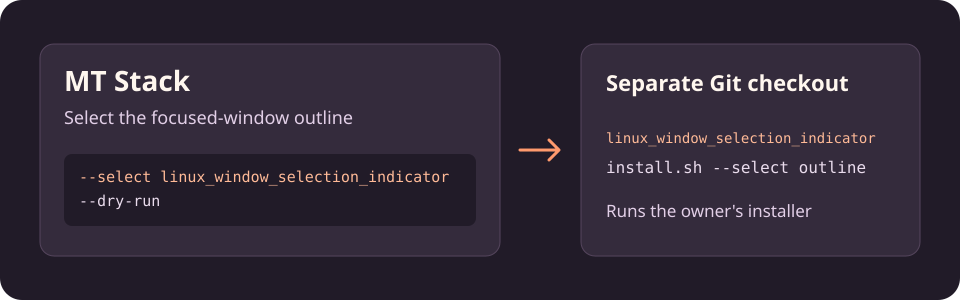

# MT Stack — Ubuntu GNOME Workstation Installer

[](https://github.com/mikaeltorni/mt_stack/commits/master)
[](https://github.com/mikaeltorni/mt_stack/graphs/commit-activity)
[](https://github.com/mikaeltorni/mt_stack/issues)

MT Stack is an Ubuntu GNOME workstation installer that lets users select desktop tools and coding-agent setup from separate Git repositories.

[Workstation profile](#install-the-workstation-profile) · [Linked projects](#linked-public-projects) · [FAQ](#mt-stack-faq) · [Verification](#verification-and-maintenance) · [MIT license](LICENSE.md)

## Ubuntu GNOME workstation quickstart

Clone MT Stack and preview the default workstation installation:

```bash
git clone https://github.com/mikaeltorni/mt_stack.git
cd mt_stack
bash install.sh --workstation --fetch --default --dry-run
```

List the workstation owners or inspect just the focused-window outline:

```bash
bash install.sh --workstation --list
bash install.sh --workstation --fetch --select linux_window_selection_indicator --dry-run
bash install.sh --workstation --fetch --list-components linux_window_selection_indicator
```

The preview prints the clone and installer commands for the focused-window
outline. The final command fetches its public checkout if needed and lists the
`outline` component. Use `--workstation --fetch --default` to install the
complete default profile on the supported Ubuntu desktop below.



MT Stack uses the [MIT license](LICENSE.md) and includes a
[disclaimer](DISCLAIMER.md). Each linked repository keeps its own license.

## Start

```bash
cd ~/projects/mt_stack
bash install.sh
```

Use arrows to move and Space to enable repositories; Right opens their
component selection, including nested configuration and installed-component
removal. Enter applies the selection and `q`/Escape cancels. Without a
terminal, no arguments install the selected profile's default components.
Use the workstation profile for a fresh checkout. The older linked profile
defaults to a prepared Programming Prompts checkout with a standalone installer.

```bash
bash install.sh --list
bash install.sh --check
bash install.sh --menu --dry-run
bash install.sh --select linux_taskbar_window_count,linux_taskbar_monitor --dry-run
bash install.sh --workstation --fetch --default --dry-run
```

Missing selected repositories are cloned from their public GitHub URLs into
`~/projects/<name>`, alongside the hub. Existing checkouts are verified and reused
without pulling, switching branches, resetting or merging. Installation then runs
that external repository's own `install.sh`.

```bash
bash install.sh --projects-dir /another/projects --select linux_taskbar_window_count
bash install.sh --offline --select linux_taskbar_window_count
```

`--projects-dir PATH` chooses an external checkout parent; the
`MT_STACK_PROJECTS_DIR` environment variable supplies its default. Checkouts inside
the hub, including symlinks resolving inside it, are rejected. `--offline`
requires existing checkouts. `--dry-run` prints clone/install commands without
creating directories, cloning or running installers. `--help` / `-h` lists flags.

## Linked public projects

The hub selects these separate projects, clones or reuses their checkouts, and
runs their own installers. Each project remains usable independently of the hub.

| Repository | Default branch | Role and connection to the stack |
| --- | --- | --- |
| [programming_prompts](https://github.com/mikaeltorni/programming_prompts) | `master` | Provides reusable coding-agent skills and policies. The public source is consumed by Linux CLI Setup for Codex and Claude, and by Programming Setup for Cursor. |
| [codex](https://github.com/mikaeltorni/codex) | `main` | Provides the terminal coding agent and its Code Mode host. It can discover installed `programming_prompts` skills, and also runs independently of the prompt library and desktop tools. |
| [linux_automatic_window_tiling](https://github.com/mikaeltorni/linux_automatic_window_tiling) | `master` | Arranges application windows through GNOME shortcuts. It complements the window-count badges and resource monitor without requiring either extension. |
| [linux_taskbar_window_count](https://github.com/mikaeltorni/linux_taskbar_window_count) | `master` | Shows per-application window counts in the GNOME taskbar, making open windows easier to identify alongside the tiling workflow. It does not call or require the tiling extension. |
| [linux_taskbar_monitor](https://github.com/mikaeltorni/linux_taskbar_monitor) | `master` | Shows system resource usage in the GNOME panel while coding agents and other applications run. It works independently of Codex, tiling and window-count badges. |

### How the projects work together

The development tools form an optional pair: `programming_prompts` supplies skills
that Codex can use, while the Codex fork supplies the coding runtime. Installing
the prompt library does not install Codex, and installing Codex does not require
the prompt library. Claude can also consume the library's native skills outside
this hub.

The three desktop projects are parallel GNOME enhancements: tiling arranges
windows, window-count badges show how many are open, and the monitor reports
system resources. They share the desktop environment, not a dependency on one
another. Select any combination to build the workspace you want.

`mt_stack` ties these projects together at installation time through its selection
menu and registry. It is not a shared background service or runtime dependency;
the owners keep their own installers, configuration, licenses and releases.

`repositories.json` records each public URL, immutable GitHub ID, owner default
branch and installer entrypoint. There are no project snapshots or submodules.
Owner fixes live in those repositories, not in this hub.

[Linux CLI Setup](https://github.com/mikaeltorni/linux_codex_claude_code_setup)
is available through the workstation profile as an optional selection. The
hub and standalone owners use a generated installer support package maintained
by the framework repository. The original `installation_scripts` chain
remains available separately.

## Install the workstation profile

Use this profile from an existing Ubuntu GNOME desktop with Git, Python 3
and sudo access. The default profile uses 13 public owner repositories and
the public Programming Prompts source.

```bash
bash install.sh --workstation --list
bash install.sh --workstation --fetch --default --dry-run
bash install.sh --workstation --fetch --default
bash install.sh --workstation --detect
```

The hub clones missing public owners at their remote default branches and
reuses existing checkouts with the expected origin. Without `--fetch`, all
selected owners must already be present. Use `--projects-dir PATH` if they
are somewhere other than `~/projects`. The optional Agent Command Center
checkout requires Git access to its private repository. Individual owners can
download packages and assets during installation.

`--default` installs base Ubuntu packages first, then GNOME, Kitty, and tmux
settings. Task Workspaces provisions Rust before the native monitor, hotkey
and workspace helpers. The remaining defaults cover tiling, taskbar tools,
Cursor and the focused-window outline. The [workstation profile](workstation.json)
lists the exact components. Cursor skills use the workstation registry and
the public `programming_prompts` source.

Run the hub as the desktop user. It calls sudo for base packages and the
Cursor system package. Cursor extensions and skills are configured under the
desktop user's account. Owner reboot requests are suppressed. Use an X11
session for X11-specific shortcuts and follow the owners' activation guidance
for new GNOME extensions.

```bash
bash install.sh --workstation --menu
bash install.sh --workstation --list-components linux_configuration_setup
bash install.sh --workstation --select linux_installations_setup,linux_configuration_setup --dry-run
bash install.sh --workstation --select linux_configuration_setup --components dark_mode
bash install.sh --workstation --fetch --select linux_codex_claude_code_setup,agent_command_center
```

The CLI setup and Agent Command Center are optional. Install the default
workstation profile first so tmux and the focused-window outline are available.
Selecting either optional owner by name runs that owner's defaults unless
you specify `--components`. `--configure`, `--export-selection`,
`--reconfigure`, `--uninstall`, and `--all` also use the selected profile.
`--all` explicitly selects every owner and its components. Review the
result with `--dry-run` before applying it.

The default profile was installed and run again on Ubuntu 24.04.5 with GNOME
46 on X11. The VM detected 52 of 53 default components, with the pointer Back
button tiler skipped because the virtual mouse lacks that button. All nine
stack-managed extensions were active after the X11 Shell reload. The two
optional agent owners were verified for command routing.

## Related Linux setup projects

The [workstation profile](workstation.json) lists the package, desktop and
development owners used by `--workstation`. The
[linked registry](repositories.json) covers the smaller set of owners in the
original profile. Both profiles use external Git checkouts. Migration and
earlier VM results are recorded in [MIGRATION.md](MIGRATION.md).

## Select components centrally or use an owner directly

```bash
bash install.sh --offline --workstation --list-components linux_window_selection_indicator
bash install.sh --offline --workstation --select linux_window_selection_indicator --components outline --dry-run
bash install.sh --offline --configure linux_taskbar_monitor
```

The hub's complete interface is:

| Form | Behavior |
| --- | --- |
| `bash install.sh`, `--menu` | Shared repository/component selection; no arguments use defaults without a terminal. |
| `--help`, `-h` | Print usage. |
| `--list`, `--check` | List registry entries or validate the public Linux registry. |
| `--default`, `--all` | Install default repositories or every component of every owner. |
| `--select OWNER,...` | Install the named owners. |
| `--components ID,...` | Select exact component IDs for a single selected owner. |
| `--components OWNER=ID,...` | Repeat this option to give multiple owners different exact selections. |
| `--list-components OWNER` | Query one owner's component catalog. |
| `--configure OWNER` | Open that owner's standalone menu. |
| `--detect` | Print `OWNER<TAB>ID<TAB>installed` or `absent`. |
| `--export-selection` | Export registry defaults in the shared master JSON schema; does not apply them. |
| `--reconfigure OWNER,...` | Reapply specified components, or each owner's currently installed components. |
| `--uninstall OWNER,...` | Remove specified components, or each owner's currently installed components. |

MT Stack sets `INSTALLER_NO_REBOOT=1` and `ISC_NO_REBOOT=1` when it runs an
owner action or opens an owner menu. This follows the original setup chain's
child installer convention.

```bash
bash install.sh --offline --select linux_taskbar_window_count,linux_taskbar_monitor \
  --components linux_taskbar_window_count=workspace_scope \
  --components linux_taskbar_monitor=rm_refresh_interval --dry-run
bash install.sh --offline --workstation --reconfigure linux_window_selection_indicator --components outline --dry-run
bash install.sh --offline --workstation --uninstall linux_window_selection_indicator --components outline --dry-run
bash install.sh --offline --detect
bash install.sh --offline --export-selection
```

Use `--list-components OWNER` for each owner's current IDs. All actions
support `--projects-dir PATH`, `--offline` and `--dry-run`. Dry-run prints
commands; existing owners may be queried to validate their component IDs and
installed state, while missing owners remain a clone/install preview. Explicit
`--components OWNER=` preserves an empty selection, including owner-defined
core-only installation. Empty uninstall is a no-op. With no installed components,
maintenance performs no action. The hub validates the entire selected plan before
install/removal; malformed, duplicate and unknown IDs reject before mutations.

The shared menu and CLI call the same owner actions with the same component
IDs. Nested configuration remains in each owner. Some actions cannot be reversed:
when an owner only clears a receipt, uninstall does not remove its packages or
undo its settings. Check that owner's README for exact removal ownership.


Each linked project remains independently usable, with no hub checkout required:

```bash
bash ~/projects/linux_codex_claude_code_setup/install.sh --list-components
bash ~/projects/codex/install.sh --select codex_cli
bash ~/projects/linux_automatic_window_tiling/install.sh
```

Read each owner's README and `bash install.sh --help` for its full interface.
The Codex fork's `codex_cli` component builds Codex and
`codex-code-mode-host` directly. Linux CLI Setup manages installs of the public
Programming Prompts content for coding-agent CLIs.

## Requirements and behavior

The hub needs Git, Bash and Python 3.11 or newer. Public cloning needs network
access; it does not require private GitHub credentials. Owners declare their own
requirements. GNOME projects target Ubuntu 24.04 / GNOME 46. Building Codex needs
Rust/Cargo, a C compiler, CMake and pkg-config, plus public build-artifact downloads.
A complete native build can take substantial time and disk space.

Run without sudo for user-mode setup. The hub forwards sudo runs to `SUDO_USER`
before cloning or installing. Owner installers report system prerequisites and
keep user files in the target home. Desktop activation follows the selected Linux
configuration policy; VM verification installed the native fork and activated the extensions in the
VM; the host desktop and agent runtimes were not redeployed.

`--list`, `--check`, `--menu`, `--default`, `--select`, `--list-components`, and
`--configure` are mutually exclusive modes. `--components` belongs with an
installation selection of exactly one owner; combining it with `--list`,
`--check`, `--list-components` or `--configure` is rejected before any owner runs.
All installation selections are validated before any owner installs. A child failure stops the run; earlier
successful owners are retained. Success and cancellation return 0; invalid
selections, checkout failures and child errors return 2.

`--check` checks the local registry and hub architecture. It does not query live
GitHub visibility or prove that unpublished owner commits are available remotely.
The registry's public status must be reverified when adding or updating links.

## MT Stack FAQ

### Which Ubuntu desktop was tested?

The default workstation profile was installed twice on Ubuntu 24.04.5 with
GNOME Shell 46 on X11. For other Ubuntu releases, GNOME versions and Wayland,
check the support notes in each owner's repository.

### How do I preview the default workstation install?

Run `bash install.sh --workstation --fetch --default --dry-run` from the hub
checkout. It prints the clone and installer commands and leaves the planned
installation unapplied.

### Does the default workstation profile need a GitHub login?

The default owner repositories and Programming Prompts source are public.
GitHub authentication is needed if you opt into an owner whose repository is
private, such as Agent Command Center.

### Does MT Stack update repositories I already cloned?

MT Stack checks the origin of each existing checkout and uses its current
files. Update the owner's checkout separately when you want a newer version.

### Can I install a single GNOME component?

Use `--list-components OWNER` to find its ID, then pass
`--select OWNER --components ID`. Add `--workstation` if the owner is in the workstation
profile and `--fetch` if its checkout needs to be cloned.

### How do I install the Programming Prompts skills from GitHub?

Use [Linux CLI Setup](https://github.com/mikaeltorni/linux_codex_claude_code_setup)
to install the public prompt source for supported coding-agent CLIs. To preview
installing the SSH VM skill, list the CLI Setup components and select its ID:

```bash
bash install.sh --workstation --fetch --list-components linux_codex_claude_code_setup
bash install.sh --workstation --fetch --select linux_codex_claude_code_setup --components skill-ssh-vm --dry-run
```

Cursor skill deployment is handled by [Programming Setup](https://github.com/mikaeltorni/linux_programming_setup).

## Codex fork differences

The public fork adds usage-limit auto-resume with a visible reset countdown,
Goal composer shortcuts (**Alt+G** to toggle `/goal`, **Alt+Shift+G** to resume an
eligible Goal), and the configurable `features.luna_reserve_auto_switch=false`
opt-out from automatic GPT Reserve switching. These are fork-specific features.

The locally prepared installer builds the selected checkout and its Code Mode
companion together, using the fork's own V8 artifact resolver. It never pulls or
changes the fork's branch. Local image-prompt ordering improvements are ahead of
the published source at this audit and are not promised by a fresh public clone.
Codex retains its Apache-2.0 license.

## Verification and maintenance

```bash
bash tests/run_tests.sh
```

The hub suite uses real Git fixture clones and external checkouts to verify
clone/reuse, offline rejection, path/origin checks, dry runs, terminal menus,
component routing, rejection preserving state, and the `master` branch contract.
All five real local owners were also queried through the hub in offline mode.
On 2026-10-23, all five owners were installed together on an Ubuntu 24.04.5
live VM with GNOME 46 on X11, using exact locally committed external checkouts.
Every owner passed repeated installation and invalid-component rejection. All
five menus opened and cancelled through the hub; each non-Codex menu also
applied a real selected component.

Both skill harnesses received 11 source-identical native skills. The desktop
extensions were active: both tiling shortcuts placed and cycled three real
windows, badges showed correct workspace counts, and Resource Monitor displayed
live metrics and its process popup. Owner checks passed 101 tiling Python tests,
195 badge installer assertions plus Node/Rust tests, and the monitor's full
`scripts/check.sh` suite including 44 Python tests.

Codex and its Code Mode companion were built from source on the VM (first
release build: 34 minutes), installed repeatedly, and checked in a sanitized
fresh login shell and the already-open desktop terminal. `codex --version`
reported `0.162.1`; the native Code Mode IPC opened a session, evaluated
`6 * 7` to `42`, and closed successfully. The Reserve-switch opt-out was also
verified through `codex features list`. Authenticated model requests and actual
usage-limit/reset events were not exercised.

Use these saved runners **inside a disposable Ubuntu GNOME VM**, after installing
the owners' documented prerequisites and checking out the prepared owner commits:

```bash
MT_STACK_VM_TEST=1 bash tests/check_vm_stack.sh discovery
MT_STACK_VM_TEST=1 bash tests/check_vm_stack.sh install-desktop
MT_STACK_VM_TEST=1 bash tests/check_vm_stack.sh install-codex
MT_STACK_VM_TEST=1 bash tests/check_vm_stack.sh install-all
MT_STACK_VM_TEST=1 python3 tests/check_vm_menu_apply.py
MT_STACK_VM_TEST=1 bash tests/check_vm_stack.sh installed
```

`discovery` runs hub tests, real owner menus, component discovery/export and
invalid-selection checks. `install-desktop` and `install-codex` install twice;
`install-all` runs the complete selection once. `installed` checks default
component detection, exact skills, executable receipts, active extensions,
Code Mode IPC and fresh-login PATH. The runners default native compilation to
two jobs with release debug information disabled; keep those settings consistent
across repeated builds. Allow substantial build storage (the test used a separate
40 GB disk). The runners do not activate newly installed extension code: follow
the desktop activation procedure before `installed`.

This is evidence for the tested Ubuntu/X11 environment, not all GNOME versions,
Wayland, hardware configurations or authenticated agent workflows. Owner fixes
remain local until explicitly published.

### Final local audit

The VM used above no longer exists. The final follow-up reran the local hub and
all five owners' relevant installer checks without contacting it. The fresh
checks passed, including 102 tiling Python tests, 35 badge Node tests and 195
badge installer assertions, and the monitor's 166 Rust and 44 Python tests.
Codex's installer checks use a mocked build; its full native build and GUI checks
remain historical VM results.

The audit fixed ignored hub component options, tiling test fixtures traversing
broken editor-skill symlinks, and monitor malformed trailing arguments reaching
downloads before rejection. The hub regression runs in `bash tests/run_tests.sh`;
the monitor regression is `python3 tests/check_argument_arity.py` in that owner's
checkout. These final changes were verified locally, without a fresh VM run.

Follow [AGENTS.md](AGENTS.md) when adding an owner. The [migration audit](MIGRATION.md)
records historical test revisions and the external checkout contract.

## Maintained installer support

Owners include a generated MIT library package with provenance and per-file
hashes, or a compatible native adapter. A clean owner checkout does not need a
private framework clone, a private sibling or a populated cache to expose its
menu and component CLI. Explicit development overrides remain supported.
Project-specific model, compiler, provider and desktop dependencies still apply.

The hub owns registration, external checkout discovery/clone/reuse and routing.
The original `installation_scripts` orchestrator remains a separate supported
consumer; it is not copied into the hub. Local verification covers terminal
selection, query/install/remove parity and isolated rejection/preservation. LUKS
verification is static only; this task did not perform a new full desktop/OS VM
installation or a complete native Codex build.
